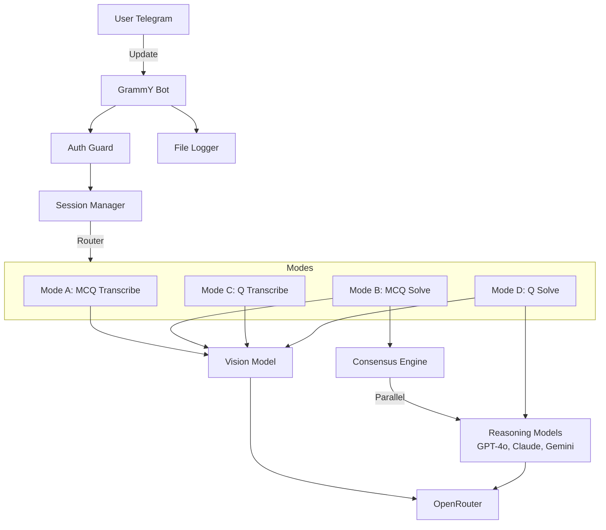

# Nexx Bot Implementation Plan

## 1. Project Initialization & Tooling

- Initialize a **Bun** project (`bun init`).
- Install dependencies: `grammy`, `zod`, `@t3-oss/env-core`, `grammy-guard`, `@grammyjs/auto-retry`, `ai`, `@ai-sdk/openai`.
- Install **Oxc** (`oxlint`) for linting as requested.
- Configure `tsconfig.json` for strict TypeScript usage.

## 2. Configuration & Environment

- **File:** `src/env.ts`
- Use `@t3-oss/env-core` and `zod` to validate:
- `BOT_TOKEN`
- `ALLOWED_USER_ID`
- `ALLOWED_CHAT_ID`
- `OPENROUTER_API_KEY`
- `ENABLE_CLIPBOARD` (Default to false/skip for now)

## 3. Core Infrastructure

- **Logger:** `src/utils/logger.ts` - Simple console + JSON file append logger.
- **AI Provider:** `src/ai/config.ts` - Configure `createOpenAI` with OpenRouter base URL.
- **Session Management:** `src/types/session.ts` - Define session states (`IDLE`, `MCQ_SOLVE`, etc.) and in-memory store.

## 4. Bot Structure (`src/bot/`)

- **Entry:** `src/bot/index.ts` - Initialize `Bot`, apply middlewares.
- **Auth:** `src/bot/middleware/auth.ts` - Use `grammy-guard` to restrict to `ALLOWED_USER_ID`.
- **Error Handling:** Global `bot.catch` to log errors and notify user.

## 5. Feature Implementation (`src/modes/`)

### Mode A: MCQ Transcribe

- **Command:** `/mcq_transcribe`
- **Logic:**

1. Receive image.
2. Send to Vision Model (e.g., GPT-4o).
3. Schema: `{ question: string, options: string[] }`.
4. Format and reply.

### Mode B: MCQ Solve (Consensus)

- **Command:** `/mcq_solve`
- **Logic:**

1. Transcribe (reuse Mode A logic).
2. **Parallel Call:** Send text to 3 models (GPT-4o, Claude 3.5 Sonnet, Gemini Pro 1.5).
3. Schema: `{ selected_option: string, reasoning: string }`.
4. **Consensus:** Group by `selected_option`. Determine majority.
5. Reply with summary.

### Mode C: Question Transcribe

- **Command:** `/question_transcribe`
- **Logic:**

1. Vision model to extract plain text.
2. Reply with text.

### Mode D: Question Solve

- **Command:** `/question_solve`
- **Logic:**

1. Transcribe (Mode C).
2. **Parallel Call:** Send to multiple solvers.
3. Schema: `{ solution_steps: string[], final_answer: string }`.
4. Send separate message for each model's solution.

## 6. Architecture Diagram

## 7. Implementation Steps

1. **Setup**: Init project, install deps, setup `env.ts`.
2. **Base Bot**: Get the bot running with auth and simple echo.
3. **AI Core**: Setup Vercel AI SDK with OpenRouter.