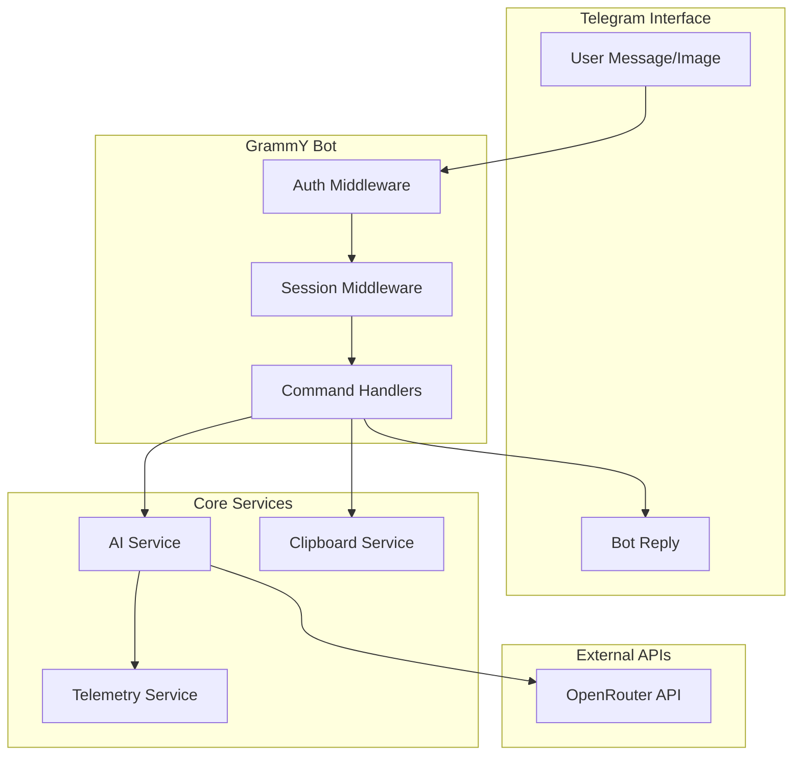
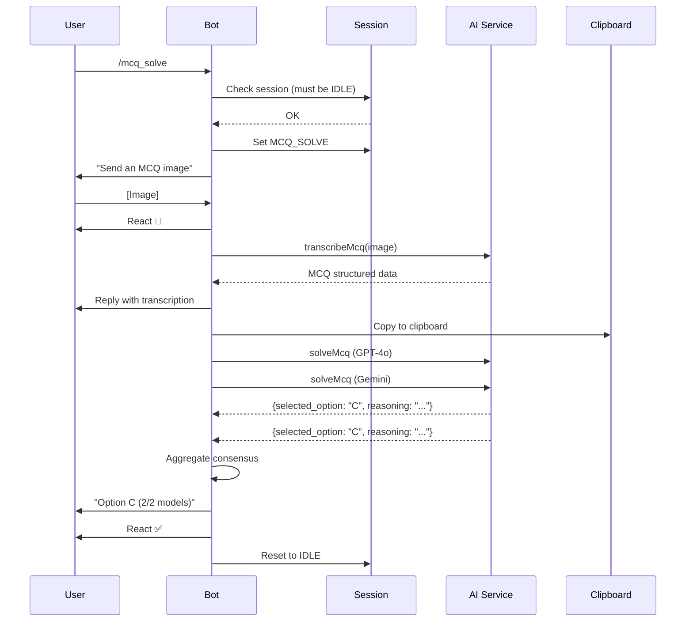

# Nexx Telegram Bot Implementation Plan

## Architecture Overview




## Project Structure

```javascript
src/
├── index.ts                 # Entry point
├── config/
│   └── env.ts              # @t3-oss/env-core validation
├── bot/
│   ├── bot.ts              # GrammY bot setup with auto-retry
│   ├── keyboard.ts         # Persistent reply keyboard
│   ├── commands/
│   │   ├── index.ts        # Command router
│   │   ├── start.ts        # /start command
│   │   ├── stop.ts         # /stop command
│   │   ├── mcqTranscribe.ts
│   │   ├── mcqSolve.ts
│   │   ├── questionTranscribe.ts
│   │   └── questionSolve.ts
│   └── middleware/
│       ├── auth.ts         # grammy-guard whitelist
│       └── session.ts      # Session state machine
├── services/
│   ├── ai/
│   │   ├── provider.ts     # OpenRouter provider (Vercel AI SDK)
│   │   ├── transcribe.ts   # Vision transcription
│   │   ├── solve.ts        # Multi-model solver
│   │   └── wrapper.ts      # Telemetry wrapper HOF
│   ├── clipboard.ts        # clipboardy wrapper
│   └── telemetry.ts        # Logging to console + JSON file
├── schemas/
│   ├── mcq.ts              # MCQ Zod schemas
│   └── question.ts         # Question Zod schemas
└── types/
    └── session.ts          # Session state types
```

---

## 1. Project Setup

Create `package.json` with dependencies:

- **Runtime**: `bun`
- **Bot**: `grammy`, `grammy-guard`, `@grammyjs/auto-retry`
- **AI**: `ai`, `@ai-sdk/openai` (for OpenRouter compatibility)
- **Validation**: `zod`, `@t3-oss/env-core`
- **Utilities**: `clipboardy`

Create `tsconfig.json` with strict TypeScript settings for Bun.Create `.env.example` documenting required variables:

- `BOT_TOKEN`, `ALLOWED_USER_ID`, `ALLOWED_CHAT_ID`
- `OPENROUTER_API_KEY`, `ENABLE_CLIPBOARD`

---

## 2. Configuration Layer

**`src/config/env.ts`** - Environment validation using `@t3-oss/env-core`:

```typescript
import { createEnv } from "@t3-oss/env-core";
import { z } from "zod";

export const env = createEnv({
  server: {
    BOT_TOKEN: z.string().min(1),
    ALLOWED_USER_ID: z.coerce.number().int().positive(),
    ALLOWED_CHAT_ID: z.coerce.number().int(),
    OPENROUTER_API_KEY: z.string().min(1),
    ENABLE_CLIPBOARD: z.enum(["true", "false"]).transform(v => v === "true"),
  },
  runtimeEnv: process.env,
});
```

If validation fails, the app crashes immediately with a clear error.---

## 3. Session Management

**`src/types/session.ts`** - Session state enum and types:

```typescript
export type SessionMode = 
  | "IDLE"
  | "MCQ_TRANSCRIBE" 
  | "MCQ_SOLVE"
  | "QUESTION_TRANSCRIBE"
  | "QUESTION_SOLVE";

export interface SessionData {
  mode: SessionMode;
}
```

**`src/bot/middleware/session.ts`** - In-memory session store:

- Store session per user ID in a `Map<number, SessionData>`
- Provide `getSession`, `setSession`, `clearSession` helpers
- Enforce single session policy (reject new session if one is active)

---

## 4. Authentication Middleware

**`src/bot/middleware/auth.ts`** - Using `grammy-guard`:

```typescript
import { guard, isUserId } from "grammy-guard";
import { env } from "../../config/env";

export const authGuard = guard(isUserId(env.ALLOWED_USER_ID));
```

All updates from non-whitelisted users are silently ignored.---

## 5. Zod Schemas for Structured Outputs

**`src/schemas/mcq.ts`**:

```typescript
export const mcqTranscriptionSchema = z.object({
  question: z.string(),
  options: z.object({
    A: z.string(),
    B: z.string(),
    C: z.string().optional(),
    D: z.string().optional(),
    E: z.string().optional(),
  }),
  context: z.string().optional(),
});

export const mcqSolveSchema = z.object({
  selected_option: z.enum(["A", "B", "C", "D", "E"]),
  reasoning: z.string(),
});
```

**`src/schemas/question.ts`**:

```typescript
export const questionTranscriptionSchema = z.object({
  question: z.string(),
  context: z.string().optional(),
});

export const questionSolveSchema = z.object({
  solution_steps: z.array(z.string()),
  final_answer: z.string(),
});
```

---

## 6. AI Service Layer

**`src/services/ai/provider.ts`** - OpenRouter setup:

```typescript
import { createOpenAI } from "@ai-sdk/openai";
import { env } from "../../config/env";

export const openrouter = createOpenAI({
  baseURL: "https://openrouter.ai/api/v1",
  apiKey: env.OPENROUTER_API_KEY,
});

export const VISION_MODEL = "google/gemini-2.0-flash-001";
export const SOLVER_MODELS = [
  "openai/gpt-4o",
  "google/gemini-2.0-flash-001",
];
```

**`src/services/ai/wrapper.ts`** - Telemetry HOF:Wraps all `generateObject` calls to:

1. Record start time
2. Execute AI call
3. Calculate latency, token usage, estimated cost
4. Log to console and append to `logs.json`

**`src/services/ai/transcribe.ts`**:

- `transcribeMcq(imageUrl: string)` - Returns structured MCQ
- `transcribeQuestion(imageUrl: string)` - Returns structured question

**`src/services/ai/solve.ts`**:

- `solveMcq(question: McqTranscription)` - Runs all SOLVER_MODELS in parallel, returns consensus
- `solveQuestion(question: QuestionTranscription)` - Runs all SOLVER_MODELS, returns array of solutions

---

## 7. Clipboard Service

**`src/services/clipboard.ts`**:

```typescript
import clipboard from "clipboardy";
import { env } from "../config/env";

export async function copyToClipboard(text: string): Promise<boolean> {
  if (!env.ENABLE_CLIPBOARD) return false;
  await clipboard.write(text);
  return true;
}
```

---

## 8. Telemetry Service

**`src/services/telemetry.ts`**:

- `logOperation(data: OperationLog)` - Logs to console + appends to `logs.json`
- Track: timestamp, mode, model, latency_ms, tokens (prompt/completion), estimated_cost

JSON file structure (array that gets read, appended to, and rewritten):

```typescript
interface OperationLog {
  timestamp: string;
  mode: SessionMode;
  model: string;
  latency_ms: number;
  tokens: { prompt: number; completion: number };
  estimated_cost_usd: number;
  success: boolean;
  error?: string;
}
```

---

## 9. Command Handlers

**`src/bot/commands/start.ts`**:

- Replies with welcome message and instructions
- Shows persistent reply keyboard

**`src/bot/commands/stop.ts`**:

- Clears current session
- Replies confirming session ended

**`src/bot/commands/mcqTranscribe.ts`**:

1. Check no active session, set mode to `MCQ_TRANSCRIBE`
2. Reply confirming mode, wait for image
3. On image: react "👀", transcribe, reply with formatted text, copy to clipboard, react "✅"
4. Reset session to IDLE

**`src/bot/commands/mcqSolve.ts`**:

1. Set mode to `MCQ_SOLVE`
2. On image: react "👀", transcribe, reply with transcription
3. Run solver consensus (parallel), aggregate results
4. Edit/reply with consensus (e.g., "Option C - Selected by 2/2 models")
5. React "✅", reset session

**`src/bot/commands/questionTranscribe.ts`**:Similar to MCQ Transcribe but uses question schema.**`src/bot/commands/questionSolve.ts`**:Similar to MCQ Solve but sends separate message per model's solution.---

## 10. Bot Setup

**`src/bot/bot.ts`**:

```typescript
import { Bot } from "grammy";
import { autoRetry } from "@grammyjs/auto-retry";

const bot = new Bot(env.BOT_TOKEN);
bot.api.config.use(autoRetry());

bot.use(authGuard);
bot.use(sessionMiddleware);
bot.use(commandRouter);

bot.catch((err) => {
  // Log error, react with "❌", notify user
});
```

**`src/bot/keyboard.ts`**:

```typescript
import { Keyboard } from "grammy";

export const mainKeyboard = new Keyboard()
  .text("/mcq_transcribe").text("/mcq_solve").row()
  .text("/question_transcribe").text("/question_solve").row()
  .text("/stop")
  .resized()
  .persistent();
```

---

## 11. Entry Point

**`src/index.ts`**:

```typescript
import { bot } from "./bot/bot";
import { env } from "./config/env";

await bot.api.sendMessage(env.ALLOWED_CHAT_ID, "Nexx is online.");
bot.start();
```

---

## 12. Message Flow Diagram



---

## Key Implementation Details

1. **Image Handling**: Use `ctx.getFile()` to get Telegram file URL, pass directly to AI vision model
2. **Parallel Solving**: Use `Promise.all()` for concurrent model calls in solve operations
3. **Consensus Logic** (MCQ Solve):

- Group responses by `selected_option`
- Find option with most votes
- Format: "Option X (selected by N/M models)"